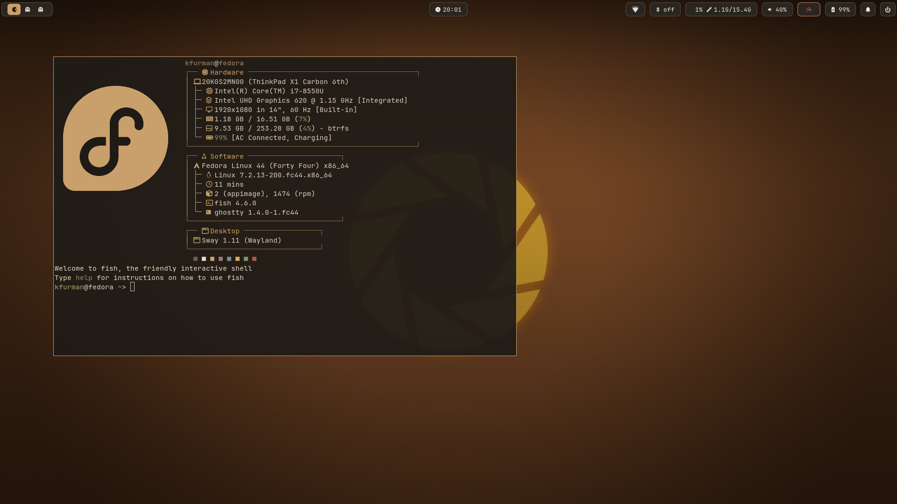

# Fedora setup

Ansible playbook for a minimal Fedora install with Sway, greetd, Waybar, Ghostty, and the Dust palette. Ported from [nixos-setup](https://github.com/krisfur/nixos-setup).



## Install

1. Run `./build-iso.sh` (needs podman or docker), find the USB stick with `lsblk`, and flash the ISO, replacing `/dev/sdX` with the whole stick, not a partition. This erases the target. Rebuild only for a new Fedora release; `ks.cfg` holds the package selection and the first-boot service.

```sh
sudo dd if=fedora-setup.iso of=/dev/sdX bs=4M status=progress conv=fsync
```

2. Boot it. In the installer, connect to wifi under **Network & Host Name**, choose the disk under **Installation Destination**, and create your user with administrator rights. Everything else is already filled in.
3. On first boot, a service clones this repo's default branch to `~/.local/share/fedora-setup`, applies the playbook with its progress on screen, and reboots into greetd. If it fails, for example with no network, the login prompt shows the reason; fix it and reboot to retry.
4. Log in, sign in to your browser, and run `~/.local/share/fedora-setup/post-install.sh`. It prompts for `gh auth login` and fingerprint enrolment, the only state that can't live in the repo (an auth token and biometric templates). Both are skipped on re-runs once done, and enrolment is skipped on machines without a supported reader.

The repo must stay at the path it was cloned to: files under `home/` are symlinked into `$HOME`, so moving the checkout breaks them.

## Apply changes later

```sh
fedora-setup-update                        # pull, apply, and upgrade packages
./bootstrap.sh                             # apply, installing Ansible if needed
ansible-playbook site.yml --check --diff   # preview
ansible-playbook site.yml                  # apply
ansible-playbook site.yml --tags user      # one role: repos, base, desktop, dev, apps, user
ansible-playbook site.yml --tags upstream  # update apps that have no repository
```

Dotfiles are symlinks, so edits under `home/` take effect without a run. Re-run only for packages, files in `/etc`, or new files under `home/`.

## Layout

| Path | Responsibility |
| --- | --- |
| `ks.cfg` | Kickstart embedded in the ISO: base packages and the one-time first-boot service. |
| `build-iso.sh` | Builds `fedora-setup.iso` from the verified netinstall ISO. |
| `post-install.sh` | Prompts for `gh auth login` and fingerprint enrolment. |
| `site.yml` | System play (root) and user play. |
| `group_vars/all.yml` | User detection, the P14s check, and pinned upstream downloads. |
| `roles/repos` | RPM Fusion and COPRs (restricted with `includepkgs`). |
| `roles/base` | Kernel arguments, firewall, locale, power profiles, wifi, zram, sysctl, and snapper. |
| `roles/desktop` | Sway session, greetd, PipeWire with speaker DSP plugins, portals, fingerprint, and Thunar. |
| `roles/dev` | Toolchains, language servers, Docker, and uinput. |
| `roles/apps` | Desktop applications, codecs, Proton Authenticator, and controller udev rules. |
| `roles/user` | Symlinks `home/` into `$HOME`, plus fonts, cursor, folder colours, dconf, default browser, Claude Code, Neovim, mise, AppImages, and GE-Proton. |
| `home/` | Dotfiles, mirroring `$HOME`. |

## Hardware

Applied only where the hardware matches, so everything else works on any machine:

| Setting | Applies to | Detected by |
| --- | --- | --- |
| Speaker DSP and `pcie_aspm.policy=powersupersave` | ThinkPad P14s Gen 5 AMD | DMI product version |
| `wifi-prefer-6ghz` and its dispatcher script | ath11k wifi | Loaded kernel module, checked at runtime |
| `mesa-va-drivers-freeworld` | AMD GPUs | PCI vendor |
| `intel-media-driver` | Intel GPUs, Broadwell or later | PCI vendor |

Re-running the playbook removes the DSP link on other models but doesn't remove a kernel argument set by an earlier run: use `sudo grubby --update-kernel=ALL --remove-args=<argument>`.

## Package sources

1. Fedora repos.
2. RPM Fusion for Steam, Discord, and full codecs.
3. Upstream-run COPRs: `imput/helium` and `jdxcode/mise`.
4. Third-party COPRs: `scottames/ghostty` and `sdegler/hyprland` (hyprlock only).
5. Upstream releases, verified by checksum and updated by `--tags upstream`: Proton Authenticator (RPM), LocalSend and RPCS3 (AppImages), and GE-Proton.
6. mise (`home/.config/mise/config.toml`) for dev tools Fedora lacks.

Anything installed with `dnf` by hand is not tracked here, so compare `dnf repoquery --userinstalled` against the playbook occasionally.

## Snapshots

On btrfs, snapper snapshots `/` before and after every dnf transaction (10 kept, no hourly timeline). `/home` is a separate subvolume and is never rolled back.

```sh
snapper list                    # find the transaction's pre snapshot
sudo snapper undochange 41..0   # revert / to that snapshot
```

Use `<pre>..0`, not `<pre>..<post>`: the rpm database is flushed after the post snapshot, so a pre..post undo restores files but leaves rpm thinking the package is still installed. `..0` also reverts any later changes to `/`, so use it for the most recent transaction.

Booting into a snapshot is not set up; if an update breaks boot, pick the previous kernel in the GRUB menu.
